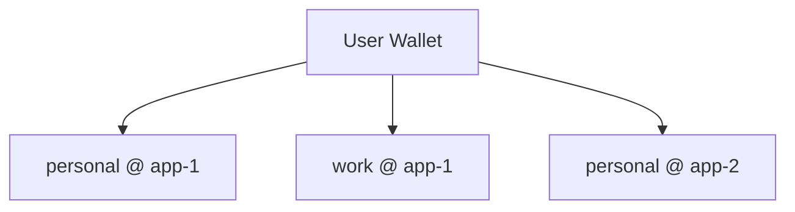

A **memory space** is the isolated unit of storage in Walrus Memory. Think of it as a folder or bucket for your memories, you choose which memory space to store into and which to retrieve from.

Each user can own as many memory spaces as they want.

## What defines a memory space?

Three values uniquely identify every memory space:

| Component | What it is |
|-----------|-----------|
| **Owner address** | The Sui wallet address that owns the memory |
| **Namespace** | A developer-defined label to group and organize memories |
| **App ID** | The Walrus Memory package ID (`MEMWAL_PACKAGE_ID`), unique per relayer deployment |

Together, `owner + namespace + app_id` form the boundary, no two memory spaces can overlap.

## Namespace

A namespace is a name you give to group related memories. One user can have multiple namespaces to separate different kinds of data.

For example:
- `personal`, store personal preferences, notes, and context
- `work`, store work-related knowledge and conversations
- `research`, store research findings and references

You set namespaces in the SDK when you create a client:

<a href="https://github.com/MystenLabs/MemWal/blob/dev/docs/fundamentals/concepts/memory-space.md" target="_blank" className="code-source-link">Source: fundamentals/concepts/memory-space.md</a>

```ts
const memwal = MemWal.create({
  key: process.env.MEMWAL_PRIVATE_KEY!,
  accountId: process.env.MEMWAL_ACCOUNT_ID!,
  serverUrl: process.env.MEMWAL_SERVER_URL,
  namespace: "personal",
});
```

## App ID

The **app ID** is the Walrus Memory package ID deployed on Sui (`MEMWAL_PACKAGE_ID`). Each relayer deployment ties to a single package ID. Seal encryption key derivation and Walrus blob metadata use this package ID.

Two separate Walrus Memory deployments can each have a user with a `personal` namespace, and their memories never mix, because the app ID (package ID) is different. This means the vector database scopes queries by `owner + namespace`, while the encryption and blob discovery layer provides an additional isolation boundary through the package ID.

## How it works in practice

<a href="https://github.com/MystenLabs/MemWal/blob/dev/docs/fundamentals/concepts/memory-space.md" target="_blank" className="code-source-link">Source: fundamentals/concepts/memory-space.md</a>



In this example, one user has three separate memory spaces:
- **personal** memories in **app-1**
- **work** memories in **app-1**
- **personal** memories in **app-2** (a completely different deployment)

Each is fully isolated. All three spaces share the same owner address, the Sui wallet address that owns the memory, so here it is the namespace and app ID that separate them. Storing into one never affects the others, and recall only searches within the specified memory space.

## What is Seal encryption?

Walrus Memory encrypts every memory with Seal, a threshold encryption scheme, before it uploads the memory to Walrus. Seal key servers are onchain objects, and encryption combines their shares according to a configured threshold. When the relayer encrypts a memory, it passes the owner address, the package ID, and the MemWal account ID. Because the package ID is part of encryption, a separate deployment with a different package ID provides cross-deployment isolation at the encryption layer.

## How should multiple agents share one account?

When several agents share one owner account, give each agent its own namespace. The OpenClaw plugin follows this pattern and derives the namespace from the agent name, for example `researcher` or `coder`. The relayer scopes recall and storage to the current namespace.

A namespace organizes data. It is not an onchain authorization boundary. Every delegate key is authorized for the whole MemWal account, so a delegate assigned to one agent can still request another namespace's Seal key. Use separate MemWal accounts when agents require cryptographic isolation.

## Switch namespaces per call

The `namespace` you set in `create(...)` is a default, not a fixed binding. Set it there when one app or agent uses one boundary. When one client needs multiple memory spaces, pass `namespace` on each call instead of creating a new client. If a call omits `namespace`, it falls back to the client config, then to `"default"`. Avoid keeping everything in `"default"` after early testing.
