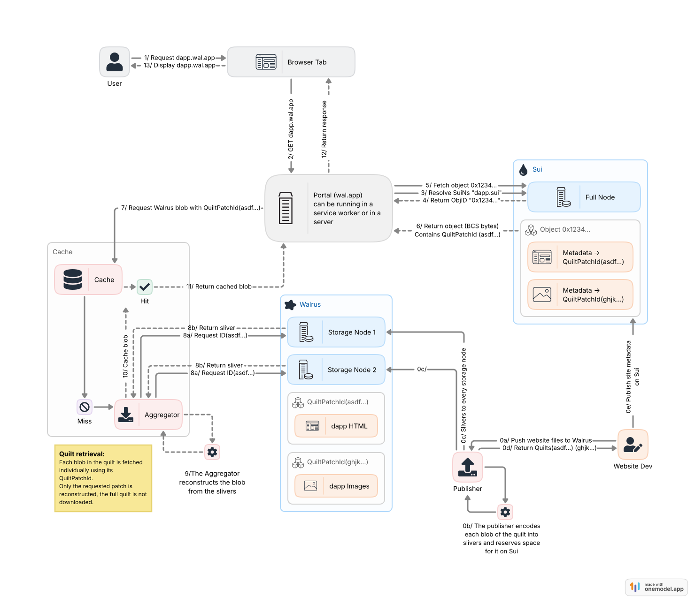

A Walrus Site is a static web site published entirely onchain, with no origin server. [Sui](https://docs.sui.io/) stores the site's ownership and resource index, and Walrus stores the resource files themselves. A portal bridges these systems and serves the site to the browser over standard HTTP.

These pieces work together to publish, resolve, and serve a site. For a description of each component in detail, see [Walrus Sites Components](/docs/sites/introduction/components).

<figure>
  <iframe src="/diagrams/interactive_walrus-sites-request_v1.html"
    style={{width:'100%',height:'560px',border:'0'}}
    title="Walrus Sites request path: the site-builder publishes files as a Walrus quilt and writes a Sui site object index; the portal resolves a request through SuiNS and the Sui site object, fetches the quilt patch from Walrus through an aggregator, and serves the HTTP response."
    loading="lazy"></iframe>
  <figcaption>
    Publishing and loading a Walrus Site. To publish, the site-builder batches your files into a
    Walrus quilt and writes a site object to Sui that maps each URL path to its quilt patch. To
    load, the portal resolves the site name through SuiNS, reads the site object on Sui to find
    the resource for the requested path, fetches that patch from Walrus through an aggregator,
    and returns a standard HTTP response to the browser. No app server sits anywhere on the path.
  </figcaption>
</figure>

## How do you publish a Walrus Site?

When you run [`site-builder deploy`](/docs/sites/getting-started/using-the-site-builder#deploy), the CLI tool performs 2 operations in sequence:

1. **Upload the files.** It uploads your site's files to Walrus by batching all files into a single storage unit called a [Walrus quilt](/docs/system-overview/quilt). Each file inside the quilt is a quilt patch, and Walrus returns a `QuiltPatchID` for each one.
2. **Write the site object.** It writes a site object to Sui. This object acts as an onchain index: it records the URL path of every resource in your site alongside the Walrus identifier needed to retrieve it. The wallet that signs this transaction becomes the owner of the site object and is the only wallet that can update or destroy it.

After publishing, your site exists entirely onchain and in Walrus storage. Your site does not need a server to stay available.

## How does a portal resolve and serve a site?

Visitors access a Walrus Site through a portal. A portal is a service that translates a browser request into Sui and Walrus lookups, then returns a standard HTTP response. Anyone can run a portal. Mysten Labs operates the Mainnet portal at [https://wal.app](https://wal.app).

When a visitor navigates to a Walrus Site URL, the portal works through the following sequence:

1. **Identify the site.** The portal reads the subdomain of the request URL and resolves it to a Sui object ID. The subdomain is either a SuiNS name or a Base36-encoded object ID (see [Domain isolation](#domain-isolation)).
2. **Look up the resource.** The portal fetches the site object's dynamic fields from Sui and finds the entry that matches the requested URL path. This entry contains the Walrus identifier for the resource and any custom response headers.
3. **Fetch the content.** The portal retrieves the resource bytes from a Walrus aggregator using that identifier. Because Walrus stores site resources as quilt patches, the aggregator reconstructs only the requested patch, not the full quilt.
4. **Return the response.** The portal sends the bytes back to the browser with the headers from the site object.

The portal repeats this sequence for every resource the browser subsequently requests, for example, stylesheets, scripts, or images referenced by `index.html`.

## Domain isolation

A shared portal must isolate the Walrus Sites it serves from each other. Without isolation, one site could read cookies or access wallet state from another. To enforce isolation, the portal serves each site from a unique subdomain of the portal's domain so that the browser's same-origin policy keeps them separate.

The portal derives the subdomain from the site's Sui object ID in one of 2 ways:

- **SuiNS name:** A human-readable name registered through [SuiNS](https://suins.io/) and pointed at the site's object ID, for example `flatland` in `https://flatland.wal.app`.
- **Base36-encoded object ID:** The full object ID re-encoded in Base36, which fits within the 63-character subdomain limit (a hex-encoded Sui object ID requires 64 characters) and is case-insensitive, unlike Base64 or Base58.

:::danger

The `wal.app` portal does not support Base36 domain resolution. To access a site by its raw object ID, use a self-hosted portal or [run a local portal](/docs/sites/portals/deploy-locally).

:::

## How do ownership and updates work?

Because a Walrus Site is a standard Sui object, it participates in Sui's ownership model. The owner can transfer, share, or destroy the site object, and can assign it a SuiNS name. Updating a site re-uploads all resource files to Walrus as a new quilt and updates the onchain index to point to the new content. The site's Sui object ID does not change between updates, so any SuiNS name or bookmark pointing to it remains valid.
